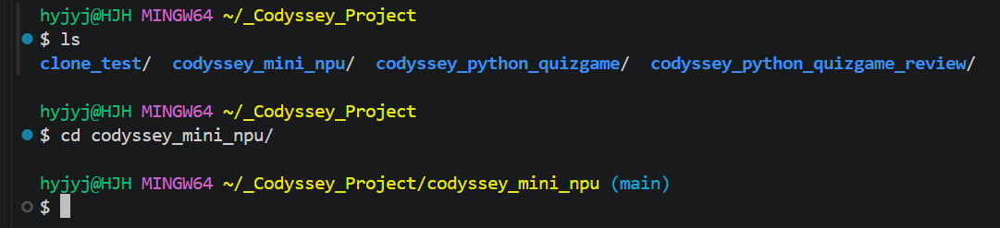
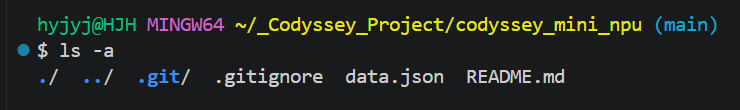

# 저장소 준비와 data.json

[← README로 돌아가기](../README.md)

GitHub에 새 저장소를 만들어 clone하고, 과제의 `data.json`을 넣어 첫 커밋(`ffd3e7f Add data.json`)을 push했습니다.

## data.json 받기, 새 저장소 만들고 clone

*~/_Codyssey_Project에서 ls(clone_test, codyssey_mini_npu, codyssey_python_quizgame, codyssey_python_quizgame_review), cd codyssey_mini_npu 후 프롬프트 (main)*

*codyssey_mini_npu에서 ls -a 결과 ./ ../ .git/ .gitignore data.json README.md*

## data.json을 저장소에 넣고 커밋

![git status에 Untracked files: data.json, git add, git commit으로 [main ffd3e7f] Add data.json 1 file changed 232 insertions, git push로 b829448..ffd3e7f main -> main, 마지막 git status는 working tree clean](images/62-commit-push.png)

*git status에 Untracked files: data.json, git add, git commit으로 [main ffd3e7f] Add data.json 1 file changed 232 insertions, git push로 b829448..ffd3e7f main -> main, 마지막 git status는 working tree clean*
