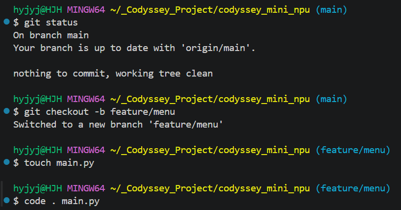
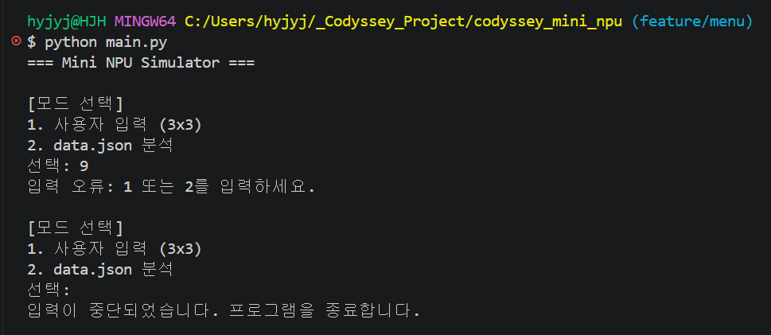
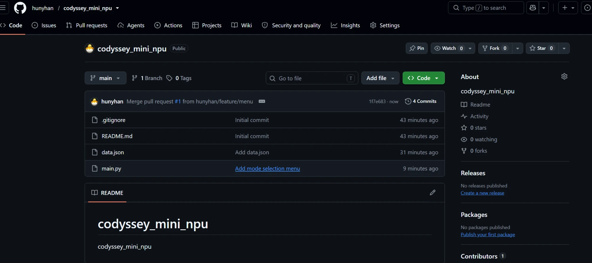

# 모드 선택 메뉴 (PR #1)

[← README로 돌아가기](../README.md)

`feature/menu` 브랜치에서 모드 선택 메뉴를 만들었습니다. 잘못된 번호는 다시 묻고, `Ctrl+C`는 안내 후 종료합니다. 첫 Pull Request로 `main`에 병합했습니다.

## 브랜치, main.py 입력, 실행 확인

*git status로 working tree clean 확인, git checkout -b feature/menu, touch main.py, code . main.py*

![python main.py에서 abc와 빈 입력은 입력 오류 후 다시 묻고, " 1 "은 [1] 필터 입력으로 넘어감](images/63-run-mode1.png)

*python main.py에서 abc와 빈 입력은 입력 오류 후 다시 묻고, " 1 "은 [1] 필터 입력으로 넘어감*

![python main.py에서 2를 넣으면 [1] 필터 로드](images/63-run-mode2.png)

*python main.py에서 2를 넣으면 [1] 필터 로드*

## 남은 실행, 커밋, push, PR 병합

*9는 입력 오류 후 다시 묻고, Ctrl+C는 "입력이 중단되었습니다. 프로그램을 종료합니다."*

![git commit으로 [feature/menu 546d2c8] Add mode selection menu 1 file changed 50 insertions, git push -u origin feature/menu로 [new branch]와 set up to track](images/63-commit-push.png)

*git commit으로 [feature/menu 546d2c8] Add mode selection menu 1 file changed 50 insertions, git push -u origin feature/menu로 [new branch]와 set up to track*

*GitHub 저장소 화면, Merge pull request #1 from hunyhan/feature/menu 1f7e683, 1 Branch, 4 Commits, main.py는 Add mode selection menu*
