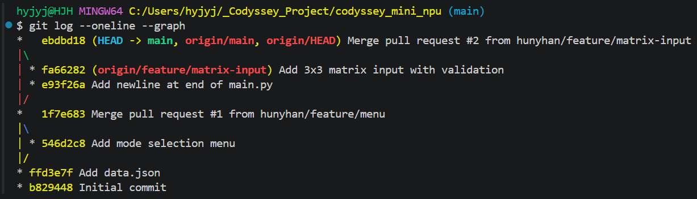

# 3×3 행렬 입력과 검증 (PR #2)

[← README로 돌아가기](../README.md)

한 줄에 숫자 3개를 공백으로 구분해 입력받습니다. 개수가 다르거나 숫자가 아니면 안내 후 그 줄을 다시 받습니다.

## 정리하고 새 브랜치

![git diff에서 마지막 print 줄이 다시 들어가고, 공백만 있는 + 줄이 빨갛게 표시됨. git commit -am으로 [feature/matrix-input e93f26a] Add newline at end of main.py 1 file changed, 2 insertions(+), 1 deletion(-)](images/64-diff-commit.png)

*git diff에서 마지막 print 줄이 다시 들어가고, 공백만 있는 + 줄이 빨갛게 표시됨. git commit -am으로 [feature/matrix-input e93f26a] Add newline at end of main.py 1 file changed, 2 insertions(+), 1 deletion(-)*

## 코드 입력과 실행

![필터 A에서 010, 1 2는 개수 오류, a b c는 숫자 오류 후 다시 받음. 필터 B, 패턴 저장 완료 후 필터 A: [[0.0, 1.0, 0.0], [1.0, 1.0, 1.0], [0.0, 1.0, 0.0]] 등 출력](images/64-run-matrix.png)

*필터 A에서 010, 1 2는 개수 오류, a b c는 숫자 오류 후 다시 받음. 필터 B, 패턴 저장 완료 후 필터 A: [[0.0, 1.0, 0.0], [1.0, 1.0, 1.0], [0.0, 1.0, 0.0]] 등 출력*

## 커밋, push, PR 병합, 정리

![git push -u origin feature/matrix-input, [new branch], set up to track](images/64-push.png)

*git push -u origin feature/matrix-input, [new branch], set up to track*

*git log --oneline --graph: ebdbd18 Merge pull request #2, fa66282 Add 3x3 matrix input with validation, e93f26a Add newline at end of main.py, 1f7e683 Merge pull request #1 ...*
