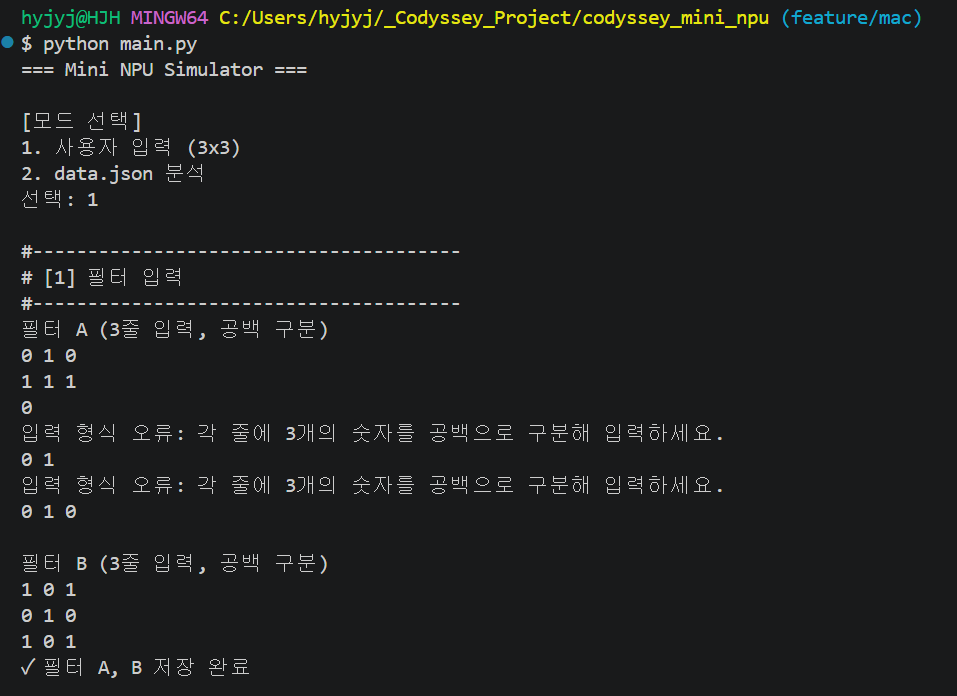
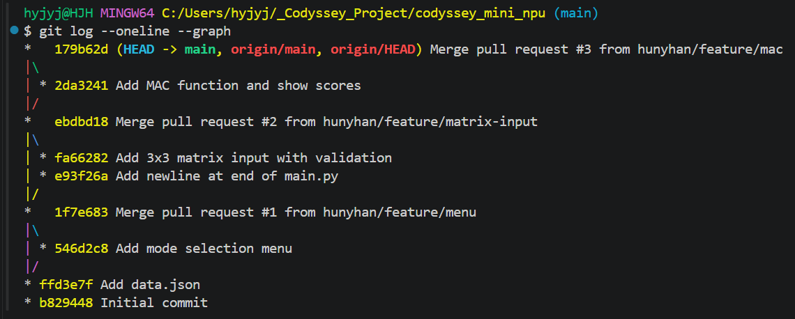

# MAC 함수 (PR #3)

[← README로 돌아가기](../README.md)

이중 반복문으로 같은 위치끼리 곱해 모두 더하는 `mac()`을 만들었습니다. 십자가 패턴은 십자가 필터 5.0, X 필터 1.0으로 PDF 예시와 같습니다.

## 브랜치, mac 함수 입력, 실행 확인

*모드 1, 필터 A 입력 중 0과 0 1은 개수 오류 후 다시 받음, 필터 B 입력*

![패턴 X 모양 입력 후 확인용 출력(필터 A, B, 패턴 리스트)이 남아 있고, [3] MAC 결과 A 점수: 1.0, B 점수: 5.0](images/65-run1-result.png)

*패턴 X 모양 입력 후 확인용 출력(필터 A, B, 패턴 리스트)이 남아 있고, [3] MAC 결과 A 점수: 1.0, B 점수: 5.0*

![두 번째 실행은 모드 2를 골라 [1] 필터 로드, (준비 중)](images/65-run-mode2.png)

*두 번째 실행은 모드 2를 골라 [1] 필터 로드, (준비 중)*

![모드 1, 패턴 십자가 모양 입력 후 [3] MAC 결과 A 점수: 5.0, B 점수: 1.0. 확인용 출력 없음](images/65-run2-cross.png)

*모드 1, 패턴 십자가 모양 입력 후 [3] MAC 결과 A 점수: 5.0, B 점수: 1.0. 확인용 출력 없음*

## 커밋, push, PR 병합, 정리

*git log --oneline --graph: 179b62d Merge pull request #3 from hunyhan/feature/mac, 2da3241 Add MAC function and show scores, 그 아래 PR #2, #1 갈래*
