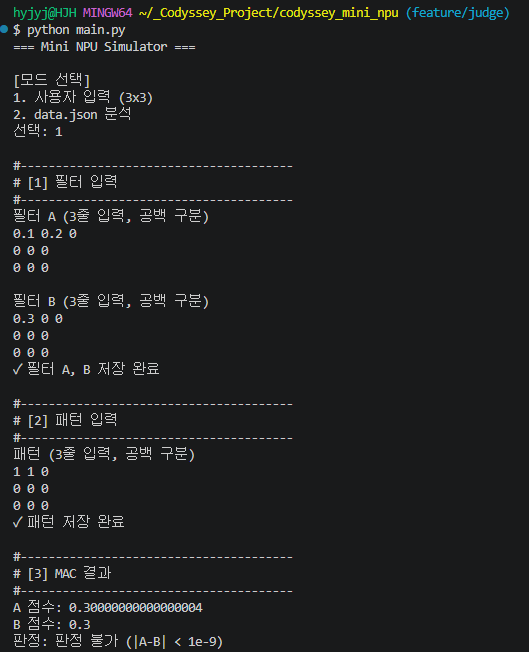
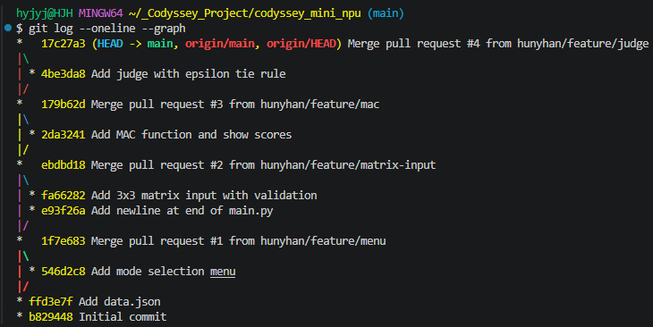

# 판정과 epsilon (PR #4)

[← README로 돌아가기](../README.md)

두 점수 차이가 `1e-9`보다 작으면 판정 불가(동점)로 처리합니다. `0.1 + 0.2`처럼 부동소수점 오차가 생기는 입력으로 확인했습니다.

## 브랜치, 판정 코드, 실행

*실행 ②: 필터 A 0.1 0.2 0, 필터 B 0.3 0 0, 패턴 1 1 0 → A 점수: 0.30000000000000004, B 점수: 0.3, 판정: 판정 불가 (|A-B| < 1e-9)*

## 커밋, push, PR, 정리

*git log --oneline --graph: 17c27a3 Merge pull request #4 from hunyhan/feature/judge, 4be3da8 Add judge with epsilon tie rule, 그 아래 PR #3, #2, #1 갈래*
