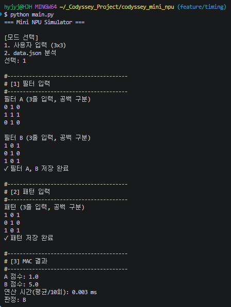
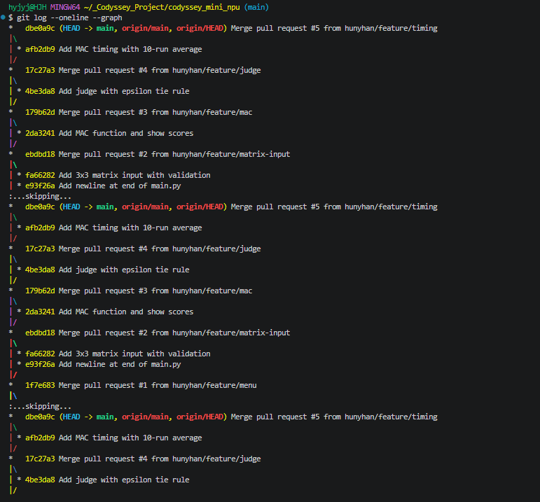
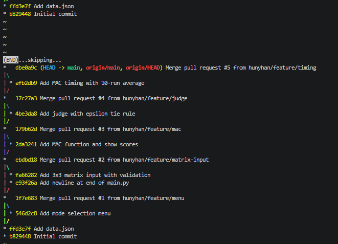
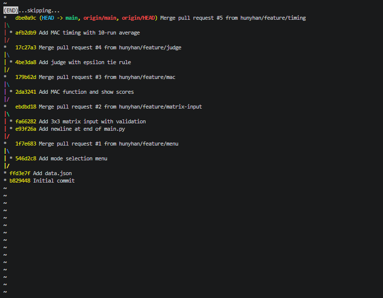

# 연산 시간 측정 (PR #5)

[← README로 돌아가기](../README.md)

`time.perf_counter()`로 MAC을 10번 반복한 평균 시간(ms)을 보여 주어 모드 1을 완성했습니다.

## 브랜치, 시간 측정 코드, 실행

*모드 1: 필터 A 십자가, 필터 B X, 패턴 X → A 점수: 1.0, B 점수: 5.0, 연산 시간(평균/10회): 0.003 ms, 판정: B*

## 커밋, push, PR, 정리

*git log --oneline --graph 결과가 여러 번 반복되고 중간에 :...skipping... 이 보임*

*아래쪽에 ~ 줄과 (END)...skipping... 이 보이고 같은 그래프가 다시 나옴*

*(END) 아래 같은 그래프, 그 아래 ~ 줄이 이어짐*
