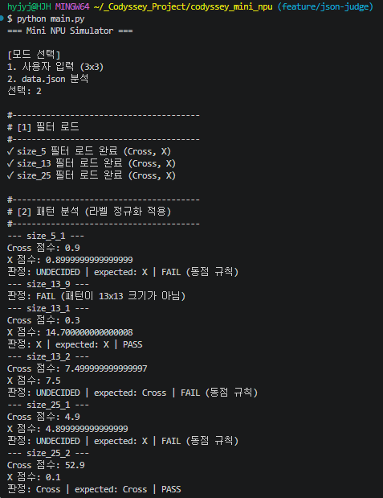
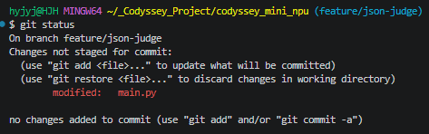
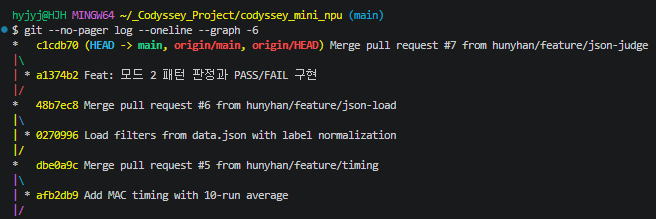

# 모드 2 패턴 판정 (PR #7)

[← README로 돌아가기](../README.md)

키 `size_N_idx`에서 크기 N을 꺼내 같은 크기 필터로 판정하고 PASS/FAIL을 출력합니다. 크기가 맞지 않는 패턴은 FAIL과 이유를 남기고 다음 케이스를 계속 처리합니다.

## 브랜치, 판정 코드, 실행

![실행 ①: [2] 패턴 분석에서 size_5_1부터 size_25_2까지 6개 케이스, PASS 3개(size_5_2, size_13_1, size_25_2), FAIL 3개(동점 규칙)](images/71-run-json-judge.png)

*실행 ①: [2] 패턴 분석에서 size_5_1부터 size_25_2까지 6개 케이스, PASS 3개(size_5_2, size_13_1, size_25_2), FAIL 3개(동점 규칙)*

*실행 ②: size_13_9 ---, 판정: FAIL (패턴이 13x13 크기가 아님), 이어서 size_13_1부터 계속 처리*

*git status: On branch feature/json-judge, modified: main.py만 있음*

## 커밋, push, PR, 정리

*git --no-pager log --oneline --graph -6: c1cdb70 Merge pull request #7 from hunyhan/feature/json-judge, a1374b2 Feat: 모드 2 패턴 판정과 PASS/FAIL 구현*
