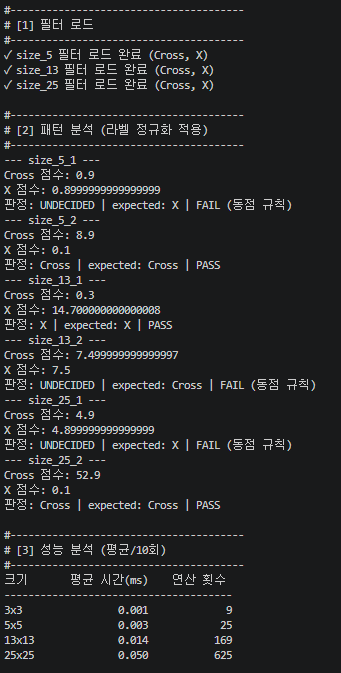
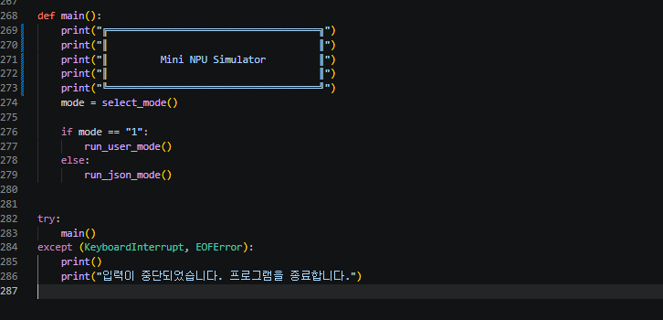
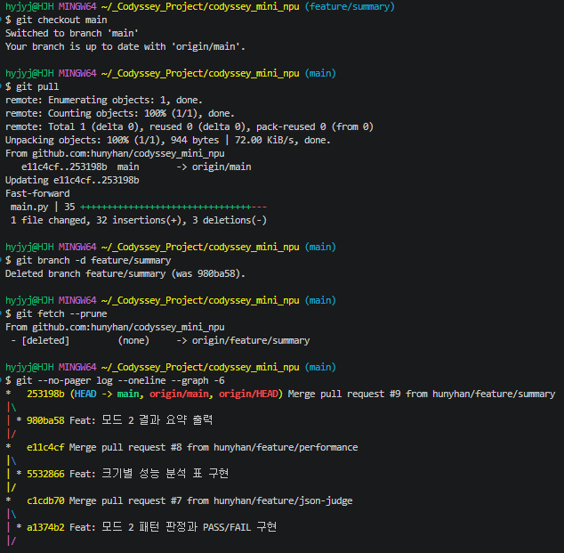

# 결과 요약 (PR #9)

[← README로 돌아가기](../README.md)

총 테스트, 통과, 실패 수와 실패 케이스 목록·이유를 출력합니다. 프로그램 제목을 상자 모양으로 바꿨습니다.

## 브랜치, 결과 요약 코드, 실행

*모드 2 전체: 필터 로드 3줄, 패턴 분석 6개(PASS 3, FAIL 3), 성능 분석 표 3x3 0.001 / 5x5 0.003 / 13x13 0.014 / 25x25 0.050*

![[4] 결과 요약: 총 테스트 6개, 통과 3개, 실패 3개, 실패 케이스 size_5_1/size_13_2/size_25_1 모두 동점 규칙](images/73-run-summary.png)

*[4] 결과 요약: 총 테스트 6개, 통과 3개, 실패 3개, 실패 케이스 size_5_1/size_13_2/size_25_1 모두 동점 규칙*

## 커밋, push, PR, 정리

*학습자가 바꾼 main() 코드: 제목을 ╔═══╗ ║ Mini NPU Simulator ║ ╚═══╝ 상자 다섯 줄로 출력*

*git pull로 e11c4cf..253198b Fast-forward main.py 32 insertions 3 deletions, branch -d, fetch --prune, 그래프 253198b Merge pull request #9, 980ba58 Feat: 모드 2 결과 요약 출력*
