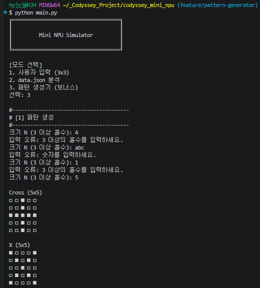
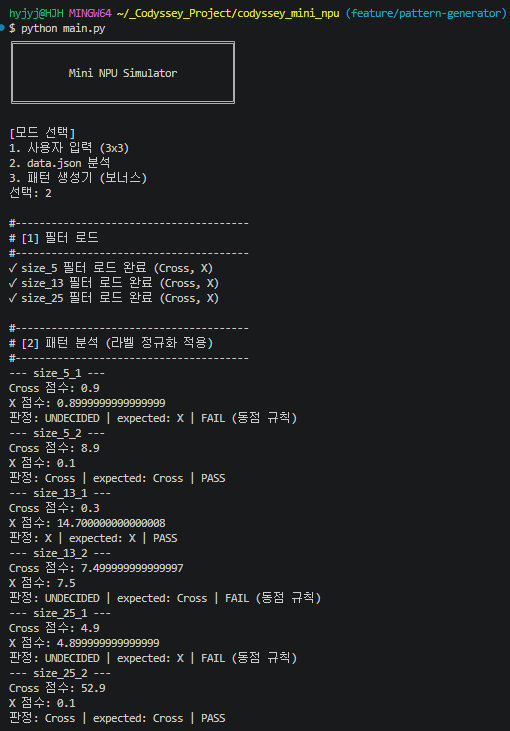
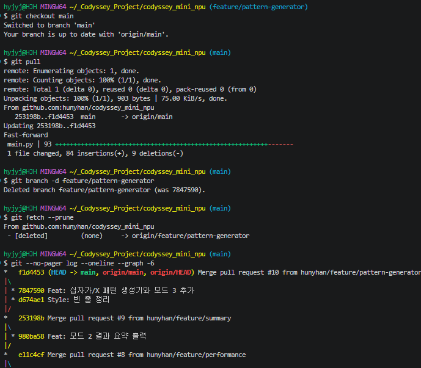

# 패턴 생성기, 보너스 2 (PR #10)

[← README로 돌아가기](../README.md)

크기 N(3 이상 홀수)을 받아 N×N 십자가와 X 패턴을 만들어 ■□로 보여 주는 모드 3을 추가했습니다. 그 전에 빈 줄을 정리하는 `Style:` 커밋을 따로 했습니다.

## 패턴 생성기 코드, 실행

*실행 ①: 모드 3, 4와 1은 3 이상의 홀수 안내, abc는 숫자 안내, 5를 넣자 Cross (5x5)와 X (5x5)가 ■□로 그려짐*

![실행 ① 이어서: [2] MAC 확인 Cross 필터 점수 9.0, X 필터 점수 1.0, 판정 Cross, [3] 성능 분석 5x5 0.001 25](images/74-run-generator-2.png)

*실행 ① 이어서: [2] MAC 확인 Cross 필터 점수 9.0, X 필터 점수 1.0, 판정 Cross, [3] 성능 분석 5x5 0.001 25*

*실행 ②: 메뉴에 3. 패턴 생성기 (보너스), 모드 2 필터 로드와 패턴 분석 6개 그대로*

![실행 ② 이어서: [3] 성능 분석 3x3 0.001 / 5x5 0.001 / 13x13 0.007 / 25x25 0.046, [4] 결과 요약 6 / 3 / 3](images/74-run-mode2-2.png)

*실행 ② 이어서: [3] 성능 분석 3x3 0.001 / 5x5 0.001 / 13x13 0.007 / 25x25 0.046, [4] 결과 요약 6 / 3 / 3*

## 기능 커밋, push, PR, 정리

*git pull로 253198b..f1d4453 Fast-forward main.py 84 insertions 9 deletions, 그래프 f1d4453 Merge pull request #10 아래 갈래에 7847590 Feat: 십자가/X 패턴 생성기와 모드 3 추가, d674ae1 Style: 빈 줄 정리 두 커밋*
