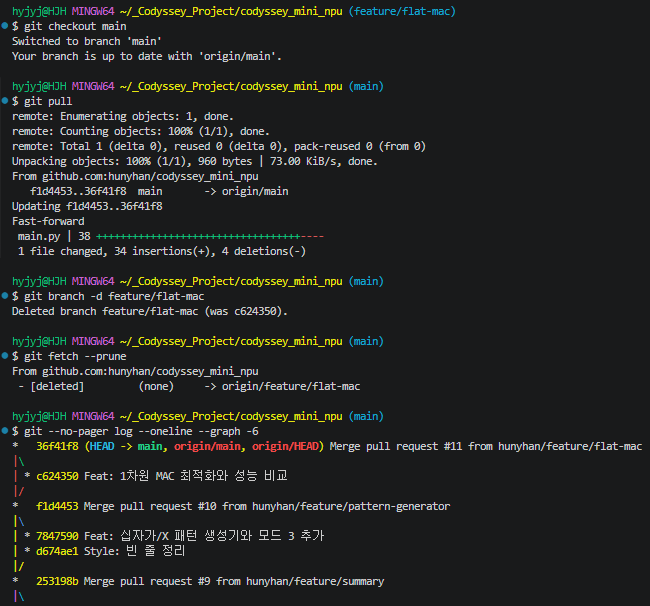

# 1차원 MAC 최적화, 보너스 1 (PR #11)

[← README로 돌아가기](../README.md)

2차원 리스트를 길이 N²인 1차원 리스트로 펴서 반복문 하나로 MAC을 계산하고, 성능 표에 2차원/1차원 시간을 나란히 보여 줍니다.

## 브랜치, 커밋, push, PR, 정리



*git pull로 f1d4453..36f41f8 Fast-forward main.py 34 insertions 4 deletions, branch -d feature/flat-mac (was c624350), fetch --prune, 그래프 36f41f8 Merge pull request #11, c624350 Feat: 1차원 MAC 최적화와 성능 비교*

## 실행 결과

<details>
<summary>터미널 원문 (모드 2 성능 분석 부분)</summary>

```text
#---------------------------------------
# [3] 성능 분석 (평균/10회)
#---------------------------------------
크기         2차원(ms)     1차원(ms)    연산 횟수
--------------------------------------------------
3x3              0.001         0.000             9
5x5              0.001         0.001            25
13x13            0.007         0.005           169
25x25            0.023         0.018           625
```

</details>
