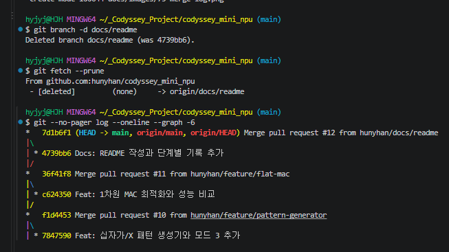

# README 작성 (PR #12)

[← README로 돌아가기](../README.md)

실행 방법, 기능 목록, 데이터 파일, 구현 요약, 결과 리포트(실패 원인 분석, 시간 복잡도)를 README에 정리하고, 단계별 기록을 `docs/`에 모았습니다.

## 커밋, push, PR, 정리

*git branch -d docs/readme (was 4739bb6), fetch --prune으로 origin/docs/readme 삭제, 그래프 7d1b6f1 Merge pull request #12 from hunyhan/docs/readme, 4739bb6 Docs: README 작성과 단계별 기록 추가*
