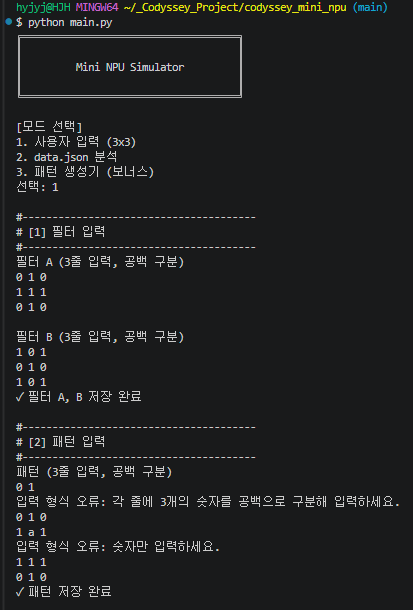
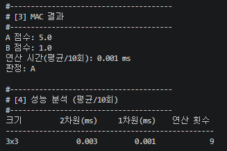
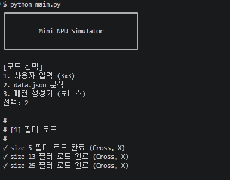
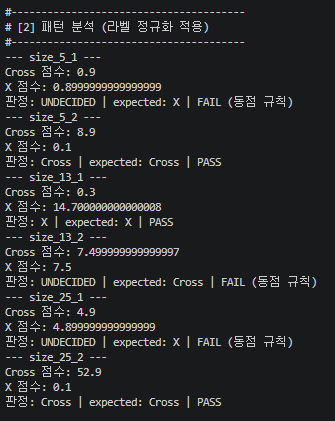
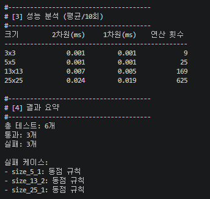
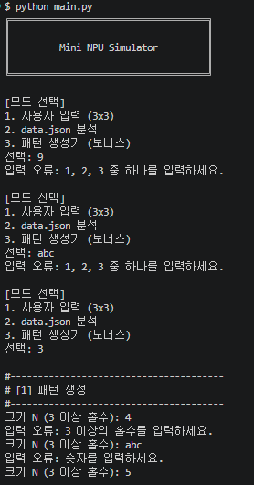
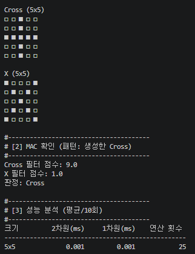
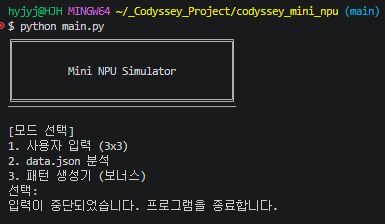

# 최종 실행 화면

[← README로 돌아가기](../README.md)

완성한 `main.py`를 처음부터 다시 실행해 README의 결과와 같은지 확인했습니다. 개발 환경은 Python 3.12.10, Git 2.54.0.windows.1, VSCode의 Git Bash 터미널입니다.

## 모드 1: 사용자 입력 예시

필터 A는 십자가, 필터 B는 X, 패턴은 십자가입니다. 패턴을 입력할 때 `0 1`(숫자 개수 부족)과 `1 a 1`(숫자 아님)을 일부러 넣어 다시 입력받는지 확인했습니다.

*모드 1: 필터 A 0 1 0 / 1 1 1 / 0 1 0, 필터 B 1 0 1 / 0 1 0 / 1 0 1, 패턴 입력 중 0 1과 1 a 1은 입력 형식 오류 후 다시 받음, 패턴 저장 완료*

*MAC 결과 A 점수 5.0, B 점수 1.0, 연산 시간(평균/10회) 0.001 ms, 판정 A, 3x3 성능 표*

## 모드 2: data.json 분석

*모드 2: size_5, size_13, size_25 필터 로드 완료 (Cross, X)*

*패턴 분석 6개: size_5_2, size_13_1, size_25_2는 PASS, size_5_1, size_13_2, size_25_1은 UNDECIDED로 FAIL (동점 규칙)*

*성능 분석 3x3 ~ 25x25 (25x25 2차원 0.024 ms, 1차원 0.019 ms), 결과 요약 총 테스트 6개, 통과 3개, 실패 3개, 실패 케이스 모두 동점 규칙*

## 잘못된 입력과 모드 3 패턴 생성기

메뉴에 `9`, `abc`, 크기에 `4`, `abc`를 일부러 넣어 다시 묻는지 확인했습니다.

*메뉴에서 9와 abc는 입력 오류 후 다시 묻고, 3 선택. 크기 N에서 4는 3 이상의 홀수 안내, abc는 숫자 안내, 5 입력*

*Cross (5x5)와 X (5x5) 패턴, MAC 확인 Cross 필터 점수 9.0, X 필터 점수 1.0, 판정 Cross, 5x5 성능 표*

## Ctrl+C로 중단

*모드 선택에서 Ctrl+C를 누르면 오류 화면 없이 입력이 중단되었습니다. 프로그램을 종료합니다.*
